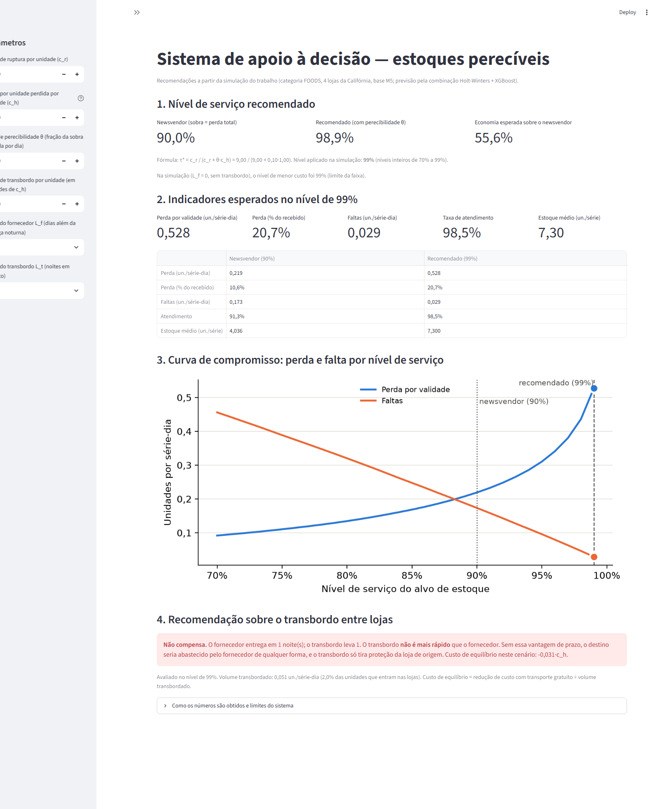

# Gestão de Estoques Perecíveis no Varejo Alimentar

Repositório de códigos e resultados do Projeto de Graduação em Engenharia de
Produção — Universidade de Brasília.

**Autor:** José Marcos Pereira Carneiro
**Matrícula:** 17/0121402

---

## Sobre o trabalho

O projeto investiga como modelos estocásticos de previsão de demanda podem
reduzir o desperdício por perecibilidade no varejo alimentar, sem comprometer o
nível de serviço, quando integrados a políticas de transbordo lateral entre
lojas de uma mesma rede.

A cadeia de análise é:

1. **Prever** a demanda como distribuição (quantis), com Holt-Winters, XGBoost
   e a combinação dos dois;
2. **Decidir** o estoque pelo quantil do nível de serviço;
3. **Avaliar** a decisão pelo custo operacional (sobra e falta), e não só pela
   acurácia estatística;
4. **Simular** o estoque perecível em vários períodos, com perda diária por
   validade;
5. **Redistribuir** excedentes entre lojas (transbordo lateral).

Base empírica: **M5 Forecasting** (Walmart), categoria de alimentos (FOODS),
quatro lojas da Califórnia — 5.748 séries produto-loja, 1.913 dias.

---

## Estrutura do repositório

```
├── README.md              este arquivo
├── requirements.txt       bibliotecas necessárias
├── sad.py                 sistema de apoio à decisão (Streamlit)
├── dados/                 arquivos do M5 e arquivos gerados (não versionados)
├── scripts/               códigos de cada etapa metodológica
└── resultados/
    ├── tabelas/           tabelas em .csv e .tex (prontas para LaTeX)
    └── figuras/           figuras em PNG, 300 dpi
```

---

## Requisitos

Python 3.12. Para instalar as bibliotecas, na pasta do projeto:

```bash
pip install -r requirements.txt
```

Versões com que os resultados foram gerados:

| Biblioteca | Versão | | Biblioteca | Versão |
|---|---|---|---|---|
| pandas | 3.0.6 | | statsmodels | 0.15.0 |
| numpy | 2.5.3 | | xgboost | 3.4.1 |
| pyarrow | 25.0.1 | | tqdm | 4.70.1 |
| scipy | 1.18.1 | | streamlit | 1.66.1 |
| matplotlib | 3.11.2 | | | |

Computador usado: processador de 8 núcleos (16 linhas de execução), 16 GB de
memória. Os passos com tempo registrado somam cerca de 50 minutos, quase tudo
no XGBoost; os passos 1 a 3 não tiveram o tempo registrado.

---

## Dados

Os arquivos do M5 **não estão no repositório**: somam centenas de megabytes e
são distribuídos pelo Kaggle sob as regras da competição. Para reproduzir:

1. Acesse a competição *M5 Forecasting — Accuracy* no Kaggle
   (<https://www.kaggle.com/competitions/m5-forecasting-accuracy/data>);
2. Baixe os três arquivos abaixo e coloque-os na pasta `dados/`:
   - `sales_train_validation.csv` (vendas diárias, 1.913 dias)
   - `calendar.csv` (datas, eventos, dias de SNAP)
   - `sell_prices.csv` (preços semanais)

Os demais arquivos de `dados/` (base analítica e previsões) são gerados pelos
scripts.

---

## Como reproduzir

Execute os scripts **nesta ordem**, a partir da pasta do projeto. Cada script
grava suas tabelas em `resultados/tabelas/` e suas figuras em
`resultados/figuras/`.

| # | Comando | O que faz | Principais saídas | Tempo |
|---|---|---|---|---|
| 1 | `python scripts/etapa1_preparar_dados.py` | Recorte FOODS/Califórnia, base analítica série × dia, colunas de controle (disponibilidade, reforma da CA_2, loja fechada), estatísticas descritivas | `dados/base_analitica.parquet`, `estatisticas_descritivas`, `proporcao_zeros`, `fig_vendas_diarias` e demais figuras descritivas | — |
| 2 | `python scripts/etapa1_verificar_disponibilidade.py` | Verifica o critério de disponibilidade (ausência de preço = produto fora de venda) | `verificacao_disponibilidade.txt`, `disponibilidade_series_tempo.png` | — |
| 3 | `python scripts/etapa1_investigacoes.py` | Investiga o evento da CA_2 (maio/2015), atrasos entre preço e venda e o valor extremo | `investigacoes_etapa1.txt`, `fig_vendas_mensais_lojas.png` | — |
| 4 | `python scripts/etapa1_sazonalidade_anual.py` | Sazonalidade anual, estabilidade entre anos e efeito dos eventos de calendário | `saz_*`, `fig_saz_*` | < 1 min |
| 5 | `python scripts/etapa3_holt_winters.py` | Holt-Winters com origem móvel e quantis empíricos | `hw_*`, `dados/previsoes_holt_winters.parquet` | ~6 min |
| 6 | `python scripts/etapa3_xgboost.py` | XGBoost global com origem móvel e quantis empíricos; importância das variáveis | `xgb_*`, `fig_xgb_importancia.png`, `dados/previsoes_xgboost.parquet` | ~32 min |
| 7 | `python scripts/etapa3_comparacao.py` | Combinação dos dois modelos; comparação por acurácia e custo, com intervalos de confiança | `comb_*`, `comp_*` | < 1 min |
| 8 | `python scripts/etapa4_simulacao.py` | Simulação multiperíodo com perecibilidade; varredura do nível de serviço (70%–99%) | `sim_*`, `fig_sim_*` | < 1 min |
| 9 | `python scripts/etapa4_mecanismo.py` | Mecanismo da mudança de ordem entre os modelos (Etapa 3 × Etapa 4) | `mec_*` | < 1 min |
| 10 | `python scripts/etapa4_heterogeneidade.py` | Teste com taxa de perecibilidade diferente por departamento | `het_*` | < 1 min |
| 11 | `python scripts/etapa5_transbordo.py` | Transbordo lateral preventivo entre as quatro lojas | `tb_*`, `fig_tb_*` | < 1 min |
| 12 | `python scripts/etapa5_transbordo.py --etapa-5b` | Transbordo sob prazo de entrega do fornecedor (0 a 3 dias) | `tbr_*`, `fig_tbr_*` | ~11 min |

Observações:

- `scripts/etapa2_variaveis.py` (variáveis do XGBoost) e
  `scripts/etapa3_avaliacao.py` (métricas, quantis e tabelas comuns a todos os
  modelos) são módulos usados pelos scripts acima; não se executam sozinhos.
- Os modelos 5 e 6 também gravam `dados/previsoes_pontuais_*.npz`, usados no
  passo 12. A combinação (`dados/previsoes_combinacao.parquet`) é gravada no
  passo 7.
- Opções úteis: `--amostra N` no Holt-Winters (teste rápido, não salva);
  `--so-tabelas` no Holt-Winters e no XGBoost (refaz as tabelas a partir das
  previsões salvas); `--ajustar` no XGBoost (refaz a escolha do objetivo e do
  número de árvores na validação interna anterior ao teste).
- Cada script grava o tempo de execução em `resultados/tabelas/*_resumo_execucao.txt`.
- Os resultados são determinísticos (XGBoost com semente fixa). Versões
  diferentes das bibliotecas podem produzir diferenças mínimas de arredondamento.

---

## Sistema de apoio à decisão (SAD)

Aplicação em Streamlit que traduz os resultados em recomendação operacional:
nível de serviço recomendado pela fórmula τ* = c_r / (c_r + θ·c_h),
indicadores esperados, curva de compromisso entre perda e falta e
recomendação sobre o transbordo (compensa ou não, e por qual margem).

```bash
streamlit run sad.py
```

O aplicativo abre no navegador. Ele **não refaz simulação**: lê a tabela
`resultados/tabelas/tbr_resultados_completos.csv`, que já está no repositório
— por isso funciona sem baixar os dados do M5. Valores de θ entre os simulados
(0,05 a 0,20) são interpolados; fora dessa faixa, o aplicativo avisa e mostra
só a fórmula.



---

## Convenções das tabelas

- `.csv`: valores com precisão completa (separador decimal ponto, codificação
  UTF-8 com BOM, para abrir no Excel).
- `.tex`: tabelas no formato `booktabs`, com números no padrão brasileiro,
  prontas para o LaTeX. Algumas tabelas largas usam `\resizebox` e pedem também
  `\usepackage{graphicx}` (indicado na primeira linha do arquivo).
- Arquivos `*_numerico.csv`: diferenças e intervalos de confiança em números,
  para conferência.

---

## Etapas metodológicas

| Etapa | Descrição | Situação |
|-------|-----------|----------|
| 1 | Coleta e integração dos dados | Implementada |
| 2 | Pré-processamento e engenharia de variáveis | Implementada |
| 3 | Modelagem preditiva probabilística | Implementada¹ |
| 4 | Simulação estocástica de estoque perecível | Implementada |
| 5 | Transbordo lateral e regras de PCP | Implementada |
| 6 | Validação e sistema de apoio à decisão | Implementada (SAD básico) |

¹ Holt-Winters, XGBoost e a combinação simples. O SARIMA, previsto no plano
original, não foi implementado.
